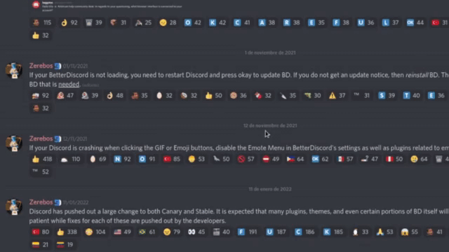

# AutoScroll
AutoScroll is a plugin for [BetterDiscord](https://betterdiscord.app/) that brings the mouse wheel button autoscroll feature to the GNU/Linux and macOS client. This plugin is a fork of the [AutoScroll extension made by Pauan](https://github.com/Pauan/AutoScroll), licensed under the [X11/MIT License](https://raw.githubusercontent.com/hackermare/BD-AutoScroll/main/LICENSE).

# Installation

If you don't have BetterDiscord installed, follow [this guide](https://docs.betterdiscord.app/users/getting-started/installation).

Once you have BetterDiscord, [download the plugin](https://betterdiscord.app/Download?id=802) and move it to the plugins folder.
